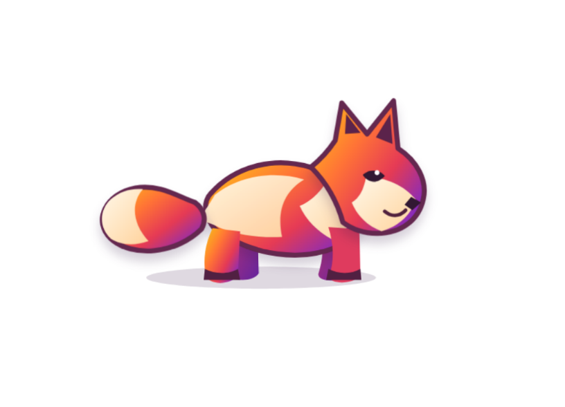

# 仅仅小狐狸 / Just a fox

一个轻量、离线运行的 Firefox 新标签页扩展。页面只保留一只会追逐光标的小狐狸；当光标移动得足够快，就能落到它身上并点击互动。



## 功能

- 页面没有文字、卡片或装饰背景，只显示小狐狸
- 标签页使用“新标签页”标题和 Firefox 内置的默认品牌图标
- 小狐狸采用橙红、紫色渐变的 Firefox 风格造型，主体为连续的一体化外轮廓
- 小狐狸以限速和缓动方式追逐光标，不会瞬移
- 光标位于狐狸身体边界内时保持不动，越过边界后才开始跟随
- 跑动包含身体起伏、四肢交替与耳朵联动，速度越快步频越高
- 转向带方向防抖、轻微起落和移动减速
- 光标离开页面或停止移动约 7 秒后会收腿卧下，并根据朝向将头部平面旋转 90°；约 24 秒后闭眼睡觉
- 卧下后的头部保持在四肢上层，不会被前爪遮挡
- 身体肩背轮廓向头部下方延伸，卧下后颈部连接保持连续
- 卧下时尾巴绕尾根旋转 120°，方向与头部旋转方向相反
- 尾巴旋转后位于身体和四肢前侧、头部后侧
- 身体尾部以圆润曲线完整闭合，尾巴根部在前层与身体轻微重叠；阴影区域随尾巴旋转，避免旋转途中被裁切
- 光标落在狐狸身体范围内时，点击随机触发挠头、歪头、跳扑或开心俯身
- 支持键盘：按 `Tab` 聚焦小狐狸，再按 `Enter` 或空格互动
- 完全离线，不申请权限、不读取浏览数据、不连接网络
- 尊重系统的“减少动态效果”设置

## 在 Firefox 中安装调试版

1. 打开 `about:debugging#/runtime/this-firefox`。
2. 点击“临时载入附加组件”。
3. 选择本项目中的 `manifest.json`。
4. 新建一个标签页即可看到效果。

临时安装会在 Firefox 重启后失效。正式长期安装需要将扩展打包并通过 Mozilla 签名。

## 项目结构

```text
.
├─ manifest.json
├─ _locales/
│  ├─ en/messages.json
│  └─ zh_CN/messages.json
├─ icons/
│  ├─ fox.svg
│  └─ firefox-newtab.png
├─ screenshots/
│  └─ 1.png
└─ newtab/
   ├─ newtab.html
   ├─ newtab.css
   └─ newtab.js
```

## 隐私

扩展没有申请任何浏览器权限。所有页面、绘图和互动逻辑都包含在扩展本地，不发送或保存任何数据。

## 声明

本扩展完全由 AI 生成，包括代码、小狐狸的形象与动作等；创建者仅进行了缺陷完善。
